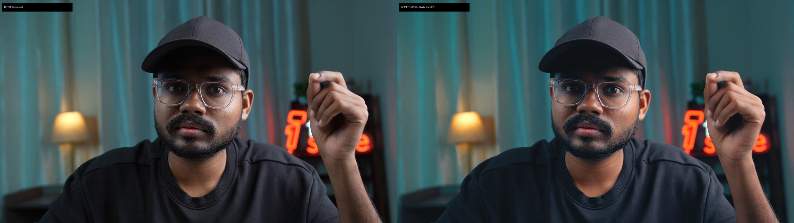

# FirstSelfie *Festival Intro*: the shipped grade (2026-10-30)

**Footage:** a 7:06 talking head, 4K 25p, 8-bit H.264. The set has a teal curtain on the left, a warm lamp, and a red neon "first selfie" logo on the right.
**Reference:** a creator video, 45–58 s. We copied only the left-side teal and the face, and ignored the red set dressing.
**Tool:** Premiere Pro Lumetri through the Premiere MCP, rendered with Media Encoder.

## Files
| File | What |
|---|---|
| `FS_MoodyTeal_Look_v1.cube` | The creative look only (33³). Lumetri > Creative > Look, Intensity 125. Same as `build_look.py` with its defaults. |
| `FS_MoodyTeal_FINAL_33.cube` | The **whole** grade baked (sliders + look). Apply alone on Rec.709 footage of this set. |

## Final Lumetri
| Basic | | Creative | |
|---|---|---|---|
| Temperature | −2 | Look | FS_MoodyTeal_Look_v1.cube |
| Tint | +3 | Look Intensity | 125 |
| Saturation | 105 | Vibrance | 0 |
| Exposure | +0.04 | | |
| Contrast | 24 | | |
| Highlights | −24 | | |
| Shadows | 30 | | |
| Whites | −4 | | |
| Blacks | 9 | | |

## Measured (Rec.709 decode)
| Region | Rough cut | Graded | Reference |
|---|---|---|---|
| Teal background | hue 184 / sat 0.37 / luma 0.36 | hue 185–186 / sat 0.45–0.49 / luma 0.33 | hue 179 / sat 0.89 / luma 0.20 |
| Face | hue 14–16 / sat 0.32–0.36 | hue 9–12 / sat 0.32–0.37, luma never below rough | hue 15 / sat 0.50 / luma 0.34 |
| Red logo | hue 6 / sat 0.80 | hue 7 / sat 0.81–0.83 | (ignored) |

The face rows use the lit 60th-percentile skin.

**Verification:**
- the full-grade LUT against Premiere's own frames: mean error 0.8/255;
- the 33-point copy against the final render: 1.3/255.

**Render:** H.264, 3840×2160, 25 fps, 53 Mbps, made with a custom "High Quality 2160 4K" preset (make_preset.py).

## How we got here (versions)
1. **Selective HSV LUT:** rejected ("painted, AI").
2. **Global look v1 + Lumetri:** natural, but the face was dark.
3. **v2** (skin lift in the look): too coloured.
4. **v1 + Exposure / Shadows / Blacks:** the face was a bit orange and saturated.
5. **Temperature −4 → −2, Tint +3, Saturation 105, Shadows 30, Intensity 125:** approved.
